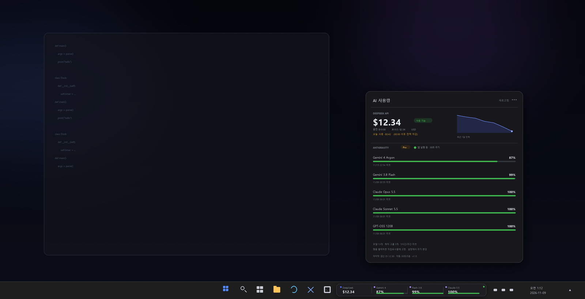
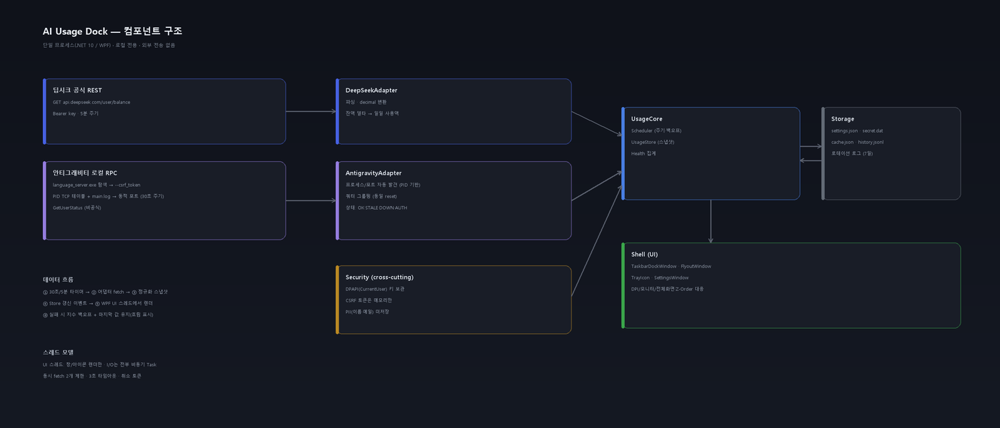
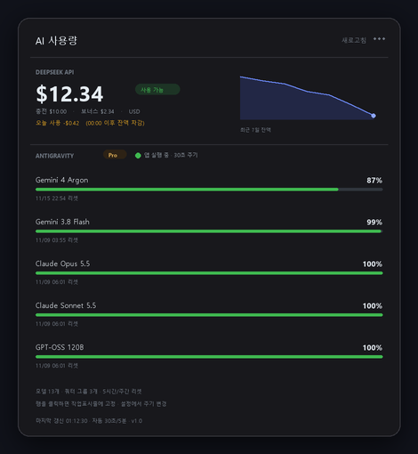
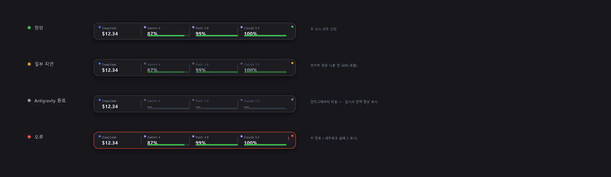

# AI Usage Dock — 프로그램 설계도

> **한 줄 정의:** Windows 11 작업표시줄에 붙어서, 딥시크 API 잔액과 안티그래비티 모델별 잔여 쿼터를 클릭 없이 보여주는 로컬 전용 위젯.
>
> | 항목 | 값 |
> |---|---|
> | 문서 버전 | v1.0 (설계 확정 전 초안) |
> | 작성일 | 2026-11-09 |
> | 대상 환경 | Windows 11 Pro (build 26300) · 64-bit · 다중 모니터 가정 |
> | 검증 환경 | 이 PC에서 실제 API/RPC를 호출해 확인 (3장) |
> | 산출물 | 본 문서 + 목업 4종(`assets/`) + 검증 스크립트(`tools/probe.ps1`) |



**읽는 순서**

| 파트 | 장 | 대상 |
|---|---|---|
| 결정만 보기 | 0, 16 | 의사결정자 |
| 데이터가 어디서 오나 | 3, 5 | 구현자 |
| 화면 | 7 | 디자이너/사용자 |
| Win32 난이도 | 8 | 구현자 |
| 일정/리스크 | 14, 15 | 관리 |

0. 한 장 요약 · 1. 목표와 범위 · 2. 요구사항 · 3. 데이터 소스 조사 · 4. 아키텍처 · 5. 데이터 수집 설계 · 6. 데이터 모델 · 7. UI 설계 · 8. 작업표시줄 도킹 · 9. 기술 스택 · 10. 보안·프라이버시 · 11. 오류 처리 · 12. 성능 예산 · 13. 테스트 계획 · 14. 리스크 · 15. 마일스톤 · 16. 열린 결정 · 부록 A~C

---

## 0. 한 장 요약

| 결정 | 내용 | 근거 |
|---|---|---|
| **표시 위치** | 작업표시줄 위에 겹치는 34~36px 높이의 독(strip). 데스크밴드 아님 | Win11은 데스크밴드를 제거함 (8.1) |
| **딥시크 데이터** | 공식 `GET /user/balance`, 5분 주기 | 공식 문서 + 이 PC 실측 200 OK |
| **안티그래비티 데이터** | 실행 중인 앱의 로컬 RPC `GetUserStatus`, 30초 주기 | 이 PC에서 실제 200 OK, 13개 모델 확인 (3.2) |
| **기술 스택** | .NET 10 (LTS) + WPF, 단일 exe, 트레이 아이콘 | 9장 비교 |
| **비밀 관리** | API 키는 DPAPI(CurrentUser)로 암호화, CSRF는 메모리에만 | 10장 |
| **실패 시** | 마지막 값을 흐리게 유지 + 상태 점 표시. 값이 사라지지 않음 | 7.4, 11장 |

**핵심 제약 (반드시 인지):**
1. 안티그래비티 쿼터는 **앱이 실행 중일 때만** 얻을 수 있다 (로컬 RPC).
2. 안티그래비티의 응답은 **공식 API가 아니다.** 앱 업데이트로 깨질 수 있다 (2.29.1에서 검증).
3. 안티그래비티는 **토큰 사용량을 주지 않는다.** 주는 것은 모델별 "잔여 비율"과 "리셋 시각"이다. 따라서 "사용량"은 `1 − 잔여비율`로 정의한다.

---

## 1. 목표와 범위

### 1.1 목표

1. **무클릭 확인** — 두 서비스의 상태를 3초 안에 파악한다. 창을 열거나 로그인할 필요가 없다.
2. **정확한 숫자** — 어림값이 아니라 실제 응답의 소수 그대로 표시한다 (예: 87.2%).
3. **가볍게 상주** — 메모리 80MB 이하, 유휴 CPU 0.1% 이하, 콜드 스타트 1.5초 이하.
4. **로컬 전용** — 외부로 나가는 요청은 딥시크 API 하나뿐. 텔레메트리 없음.

### 1.2 비목표 (v1에서 하지 않는다)

| 하지 않는 것 | 이유 |
|---|---|
| 토큰 단위 사용 이력/비용 분석 | 안티그래비티가 토큰 수를 노출하지 않음. 딥시크도 사용량 API가 없음 |
| 결제/충전 링크 자동화 | 범위 밖. 브라우저 링크만 제공 |
| 멀티 계정/팀 계정 전환 | v1은 현재 로그인된 계정 1개 |
| macOS/Linux | Win32 작업표시줄 전용 설계 |
| 안티그래비티 UI 자동화(스크래핑) | 취약. v1에서는 RPC 실패 시 "사용 불가"로 정직하게 표시 |
| Windows Widgets 보드 연동 | 작업표시줄이 아니라 별도 패널이라 요구와 불일치 (8.8) |

### 1.3 용어

| 용어 | 정의 |
|---|---|
| **독(strip)** | 작업표시줄 위에 붙는 작은 상시 표시 창 |
| **플라이아웃** | 독을 클릭했을 때 위로 뜨는 상세 패널 |
| **잔여율** | `quotaInfo.remainingFraction` (0.0~1.0). 1.0 = 100% 남음 |
| **사용률** | `1 − 잔여율`. 화면에는 잔여율을 크게, 사용률은 상세에 보조로 표시 |
| **쿼터 그룹** | 같은 `(remainingFraction, resetTime)`을 공유하는 모델 묶음 (5.3.4) |
| **신선도(freshness)** | 마지막 성공 이후 경과 시간. 2×주기를 넘으면 STALE |

---

## 2. 요구사항

### 2.1 기능 요구사항

| ID | 요구사항 | 우선순위 | 수용 기준 |
|---|---|---|---|
| FR-01 | 딥시크 잔액을 통화와 함께 표시 | P0 | `$12.34` 형태. 소수 2자리, 통화 코드가 USD면 `$`, CNY면 `¥` |
| FR-02 | 잔액을 5분마다 자동 갱신 + 수동 새로고침 | P0 | 수동 새로고침은 1초 내 반영, 실패 시 토스트 |
| FR-03 | 안티그래비티 모델별 잔여율을 독에 표시 | P0 | 최대 3개 그룹을 독에, 전체는 플라이아웃에 |
| FR-04 | 각 모델의 리셋 시각을 로컬 시간으로 표시 | P0 | `11/15 22:54 리셋` 형식, 24시간 이내면 `3시간 12분 후` |
| FR-05 | 표시할 모델 그룹을 사용자가 고정(pin) | P1 | 설정에서 체크, 즉시 독 반영 |
| FR-06 | 4가지 상태를 시각적으로 구분 | P0 | 정상/지연/앱종료/오류 (7.4 표) |
| FR-07 | 클릭 시 상세 플라이아웃 | P0 | 잔액 내역, 모델 전체 목록, 마지막 갱신 |
| FR-08 | 설정 창 | P1 | API 키, 주기, 고정 모델, 시작 프로그램, 테마, 모니터 |
| FR-09 | Windows 시작 시 자동 실행 | P1 | HKCU Run 등록/해제 토글 |
| FR-10 | 임계값 알림 (선택) | P2 | 잔액 < $2 또는 잔여율 < 15%에서 트레이 풍선 1회 |
| FR-11 | 트레이 아이콘 | P1 | 좌클릭=플라이아웃, 우클릭=메뉴, 아이콘 색=최악 상태 |
| FR-12 | 다중 모니터/위치 오프셋 | P2 | 모니터 선택 + 좌우 오프셋 ±400px |

### 2.2 비기능 요구사항

| ID | 요구사항 | 측정 방법 |
|---|---|---|
| NFR-01 | 작업 집합 ≤ 80MB | 작업 관리자, 24시간 상주 후 |
| NFR-02 | 유휴 CPU ≤ 0.1% | 5분 평균 |
| NFR-03 | 콜드 스타트 ≤ 1.5초 (캐시 표시까지) | 프로세스 시작→첫 렌더 |
| NFR-04 | API 키 평문 저장 금지 | 파일 검사 + DPAPI 복호화 테스트 |
| NFR-05 | 크래시 후 설정/캐시 보존 | 강제 종료 3회 반복 |
| NFR-06 | 오프라인에서 마지막 값 + 경과 시간 표시 | 네트워크 차단 후 확인 |
| NFR-07 | DPI 100/125/150/200%, 다중 모니터 | 각 배율에서 픽셀 정렬 확인 |
| NFR-08 | 설치 없이 실행 가능한 포터블 exe | 단일 파일 복사 실행 |
| NFR-09 | 안티그래비티 미설치 PC에서도 정상 동작 | 딥시크만 표시 |

### 2.3 사용자 시나리오

**S1 — 아침에 작업 시작**
08:55 로그인 → 독이 바로 보인다. `$12.34 | Argon 87% | Flash 99% | Claude 100%`. 어제보다 잔액이 $0.42 줄었다는 것을 플라이아웃에서 확인.

**S2 — 안티그래비티를 끄고 작업**
독의 안티그래비티 타일이 회색 `—`로 바뀌고, 옆에 작은 시계 아이콘. 딥시크 타일은 정상. 플라이아웃에는 "앱이 꺼져 있음 · 마지막 확인 12분 전"이 표시되고, 마지막 값은 흐리게 남는다.

**S3 — 잔액이 바닥나기 직전**
잔액이 $2 미만이 되면 트레이 풍선 1회. 독의 딥시크 타일이 앰버색이 된다. 클릭하면 충전 페이지 링크.

---

## 3. 데이터 소스 조사 (이 PC에서 실측, 2026-11-09)

### 3.1 딥시크 잔액 — 공식 REST API

공식 문서: [Get User Balance](https://api-docs.deepseek.com/api/get-user-balance/)

```http
GET https://api.deepseek.com/user/balance
Authorization: Bearer <DEEPSEEK_API_KEY>
```

실측 응답 (값은 마스킹):

```json
{
  "is_available": true,
  "balance_infos": [
    {
      "currency": "USD",
      "total_balance": "12.34",
      "granted_balance": "2.34",
      "topped_up_balance": "10.00"
    }
  ]
}
```

확인된 사실:

| 항목 | 값 | 설계에 미치는 영향 |
|---|---|---|
| 응답 코드 | 200 OK | 단순 폴링 가능 |
| 금액 타입 | **문자열** (`"110.00"`) | `decimal.Parse` + InvariantCulture 필수. `double` 금지 |
| 통화 | `USD` 또는 `CNY` | 기호/소수 자릿수를 통화별로 처리 |
| 배열 길이 | 보통 1개, 통화별로 여러 개 가능 | 첫 항목이 아니라 **통화별 매핑**으로 처리 |
| 사용량 API | **없음** | 잔액 델타로 일일 사용액을 추정 (5.2.3) |
| 인증 실패 | 401 | "키 확인" 상태로 전환, 재시도 중단 |

**주의:** 이 PC의 키는 DSH가 쓰는 키였다. 위젯은 **자체 설정에서 키를 입력받아** DPAPI로 저장한다. DSH 설정 파일을 읽지 않는다 (결합도/보안).

### 3.2 안티그래비티 모델 쿼터 — 로컬 RPC (비공식)

#### 3.2.1 앱 구조 (실측)

| 항목 | 실측값 |
|---|---|
| 설치 경로 | `%LOCALAPPDATA%\Programs\antigravity\Antigravity.exe` |
| 버전 | **2.29.1** (Electron 44.5.1 / Chrome 152) |
| 프로세스 | `Antigravity.exe`(main) → `resources\bin\language_server.exe`(자식) |
| LS 인자 | `--csrf_token <uuid> --app_data_dir antigravity --https_server_port 0` |
| 로컬 UI 서버 | `https://127.0.0.1:1908/` (**동적 포트**) |
| CDP (개발자 도구) | `127.0.0.1:1906`, `DevToolsActivePort` 파일에 기록 |
| 로그 | `%APPDATA%\Antigravity\logs\main.log`, `language_server.log` |

`main.log`에 포트가 명시된다:

```
[2026-11-08 23:33:38.970] [info]    Local:       https://127.0.0.1:1908/
[2026-11-08 23:33:38.833] [info]  Host bridge server listening on http://127.0.0.1:1907
```

동적 포트이므로 **매번 발견해야 한다** (`Port changed!` 로그가 실제로 찍힘).

#### 3.2.2 요청

```http
POST https://127.0.0.1:1908/exa.language_server_pb.LanguageServerService/GetUserStatus
Content-Type: application/json
Connect-Protocol-Version: 1
x-codeium-csrf-token: <language_server.exe 인자에서 추출한 uuid>

{"metadata":{"ideName":"antigravity","extensionName":"antigravity","ideVersion":"unknown","locale":"en"}}
```

검증 결과:

| 조건 | 결과 |
|---|---|
| CSRF 헤더 없음 | `401 {"code":"unauthenticated","message":"unauthenticated: missing CSRF token"}` |
| CSRF 헤더 있음 | `200`, **17,579 bytes** |
| 빈 body `{}` | 400 (metadata 필요) |
| GET | 405 |

→ **CSRF 토큰은 필수**이고, 이는 `language_server.exe` 프로세스의 커맨드라인에서 읽을 수 있다(같은 사용자 권한이면 관리자 불필요).

#### 3.2.3 응답 구조 (핵심 필드만)

```jsonc
{
  "userStatus": {
    "planStatus": {
      "planInfo": { "planName": "Pro", "teamsTier": "TEAMS_TIER_PRO",
                    "monthlyPromptCredits": 50000 },
      "availablePromptCredits": 500,
      "availableFlowCredits": 100
    },
    "cascadeModelConfigData": {
      "clientModelConfigs": [
        {
          "label": "Gemini 4 Argon (High)",
          "modelId": "gemini-4-argon-high",
          "quotaInfo": {
            "remainingFraction": 0.87229455,      // 0.0 ~ 1.0
            "resetTime": "2026-11-15T13:54:57Z"   // ISO 8601 UTC
          }
        }
        // ... 모델 수만큼
      ]
    },
    "userTier": { "id": "g1-pro-tier", "name": "Google AI Pro" }
  }
}
```

**무시해야 할 필드:** `email`, `name`, `profilePictureUrl`(base64 이미지, 응답의 약 1KB), `supportedMimeTypes`(모델당 수십 개), `acceptedLatestTermsOfService`. 파서는 필요한 4개 필드만 읽고 나머지는 버린다.

#### 3.2.4 실측: 13개 모델, 3개 쿼터 그룹 (2026-11-09 01:00 KST 스냅샷)

| 표시 이름 | modelId | 잔여율 | 리셋 (KST) |
|---|---|---:|---|
| Gemini 4 Argon (High/Medium/Low) | `gemini-4-argon-*` | **87.2%** | 11/15 22:54 |
| Gemini 3.8 Flash (High/Medium/Low) | `gemini-3.8-flash-*` | **99.5%** | 11/09 03:55 |
| Claude Opus 5.5 (Low/Medium/High) | `claude-opus-5-5-*` | **100%** | 11/09 06:01 |
| Claude Sonnet 5.5 (Low/Medium/High) | `claude-sonnet-5-5-*` | **100%** | 11/09 06:01 |
| GPT-OSS 120B (Medium) | `gpt-oss-120b-medium` | **100%** | 11/09 06:01 |

핵심 관찰:

1. 같은 모델 패밀리의 High/Medium/Low는 **쿼터를 공유**한다 (값·리셋 시각 동일).
2. Claude 3종과 GPT-OSS는 리셋 시각까지 동일 → **하나의 "3P 풀"**로 보인다.
3. 즉 13개 행이 3개 그룹으로 접힌다. 독에는 그룹 3개만, 플라이아웃에는 13개 전부.
4. `resetTime`은 UTC(`Z`). 표시할 때 KST로 변환.
5. 응답에 **모델 목록이 하드코딩되어 있지 않다.** 라벨/모델 ID는 언제든 바뀔 수 있다.
6. `resetTime`은 **고정값이 아니다.** 10분 사이에 `21:01Z → 21:07Z`로 움직였다(사용에 따라 5시간 창이 갱신되는 것으로 보임). 값을 캐시해 "리셋까지 N시간"을 계산하지 말고, **매 응답의 `resetTime`을 그대로** 쓴다.

#### 3.2.5 제약과 리스크

| 제약 | 영향 | 대응 |
|---|---|---|
| 앱이 실행 중이어야 함 | 앱 종료 시 쿼터 없음 | 마지막 값 유지 + "앱 꺼짐" 표시 |
| 비공식 내부 RPC | 앱 업데이트 시 경로/필드 변경 가능 | 버전 무관 파서 + 실패 시 명확한 오류 |
| CSRF 토큰이 재시작마다 변경 | 캐시 불가 | 요청 실패 시 프로세스 재탐색 |
| 포트가 동적 | 하드코딩 불가 | 로그 파싱 → 포트 프로브 순서 |
| PII 포함 응답 | 이름/이메일/프로필 이미지 | 메모리에서만 사용, 저장·로그 금지 |

### 3.3 두 소스 비교

| 항목 | 딥시크 | 안티그래비티 |
|---|---|---|
| 공식성 | 공식 문서 | 비공식 (내부 RPC) |
| 인증 | Bearer API 키 | 로컬 CSRF 토큰 (프로세스 인자) |
| 앱 실행 필요 | 아니오 | **예** |
| 주는 값 | 잔액(통화별) | 모델별 잔여율 + 리셋 시각 + 플랜 |
| 사용 이력 | 없음 (델타 추정) | 없음 (잔여율만) |
| 폴링 비용 | 무료, 가벼움 | 로컬, 가벼움 (17KB) |
| 깨질 확률 | 매우 낮음 | 중간 (앱 업데이트 시) |

---

## 4. 아키텍처

### 4.1 전체 구조



### 4.2 레이어와 책임

| 레이어 | 구성 | 책임 | 하지 않는 것 |
|---|---|---|---|
| **Sources** | 딥시크 REST, 안티그래비티 로컬 RPC | 원본 응답 제공 | — |
| **Adapters** | `DeepSeekAdapter`, `AntigravityAdapter` | 발견·인증·요청·파싱·정규화 | UI 접근, 저장 |
| **Core** | `Scheduler`, `UsageStore`, `HealthMonitor` | 주기, 재시도, 스냅샷 보관, 상태 집계 | 렌더링 |
| **Shell** | `TaskbarDockWindow`, `FlyoutWindow`, `TrayIcon`, `SettingsWindow` | 표시와 입력 | 직접 HTTP 호출 |
| **Storage** | `SettingsStore`, `CacheStore`, `LogSink` | 설정/캐시/로그 | 비즈니스 로직 |

**의존성 방향:** Shell → Core → Adapters. 어댑터는 Core의 인터페이스만 알고, UI는 어댑터를 모른다.

### 4.3 프로세스/스레드 모델

- **단일 프로세스.** 별도 서비스/드라이버 없음.
- **UI 스레드(WPF Dispatcher):** 창, 트레이 아이콘, 렌더링만. 절대 블로킹 호출 금지.
- **I/O:** 전부 `async`/`await`. `HttpClient` 1개를 `SocketsHttpHandler`로 재사용.
- **타이머:** `PeriodicTimer` 2개(딥시크 5분, 안티그래비티 30초). UI 갱신은 `Dispatcher.BeginInvoke`.
- **동시성:** fetch는 최대 2개. 겹치면 이전 요청 취소 토큰으로 중단.
- **종료:** 트레이 "종료" → CancellationToken 취소 → 저장 → `Application.Shutdown`.

### 4.4 데이터 흐름 (한 주기)

```
[PeriodicTimer] ──tick──▶ Scheduler
                            │
              ┌─────────────┴─────────────┐
              ▼                           ▼
     DeepSeekAdapter.FetchAsync   AntigravityAdapter.FetchAsync
        (HTTP 5s timeout)            (discover→RPC 3s timeout)
              │                           │
              ▼                           ▼
        DeepSeekBalance             AntigravityUsage
              └─────────────┬─────────────┘
                            ▼
                     UsageStore.Apply(snapshot)
                            │  (변경 시 이벤트)
                            ▼
                 Dispatcher → Dock/Flyout/Tray 갱신
```

### 4.5 프로젝트 구조 (제안)

```
ai-usage-dock/
├─ src/
│  ├─ AiUsageDock.App/              # WPF 진입점, 창, 트레이, 설정 UI
│  │  ├─ App.xaml(.cs)
│  │  ├─ Shell/TaskbarDockWindow.xaml(.cs)
│  │  ├─ Shell/FlyoutWindow.xaml(.cs)
│  │  ├─ Shell/SettingsWindow.xaml(.cs)
│  │  ├─ Shell/TrayIconHost.cs
│  │  └─ Interop/NativeMethods.cs   # SHAppBarMessage, DWM, DPI
│  ├─ AiUsageDock.Core/             # 순수 로직 (UI 참조 없음)
│  │  ├─ Providers/IUsageProvider.cs
│  │  ├─ Providers/DeepSeek/…
│  │  ├─ Providers/Antigravity/…
│  │  ├─ Scheduling/Scheduler.cs
│  │  └─ Storage/{SettingsStore,CacheStore}.cs
│  └─ AiUsageDock.Core.Tests/       # xUnit + fixture
├─ assets/
└─ tools/make_mocks.py
```

**테스트 가능성:** `Core`는 WPF를 참조하지 않으므로 콘솔/유닛 테스트에서 그대로 실행 가능. 어댑터는 `HttpMessageHandler` 주입으로 가짜 응답을 먹인다.

---

## 5. 데이터 수집 설계

### 5.1 공통 계약

```csharp
public interface IUsageProvider
{
    string Id { get; }                 // "deepseek" | "antigravity"
    TimeSpan DefaultInterval { get; }
    Task<ProviderResult> FetchAsync(CancellationToken ct);
}

public enum ProviderHealth { Ok, Stale, AppDown, AuthFailed, NetworkFailed, ParseFailed }

public sealed record ProviderResult(
    ProviderSnapshot? Snapshot,        // 실패 시 null
    ProviderHealth Health,
    string? ErrorCode,                 // "http_401", "csrf_missing", "port_closed" …
    string? ErrorDetail);              // 로그용. UI에는 노출 금지
```

- 어댑터는 **절대 예외를 던지지 않는다.** 모든 실패는 `ProviderResult`로 정규화한다 (스케줄러가 죽지 않게).
- 스냅샷에는 `FetchedAt`(UTC)이 반드시 들어간다. UI는 이 값으로 신선도를 계산한다.

### 5.2 DeepSeekAdapter

**요청**

| 항목 | 값 |
|---|---|
| URL | `https://api.deepseek.com/user/balance` |
| 메서드 | GET |
| 헤더 | `Authorization: Bearer <key>`, `Accept: application/json` |
| 타임아웃 | 5초 |
| 재시도 | 401/403은 즉시 중단. 5xx·타임아웃은 2초 후 1회 |

**파싱**

```csharp
var infos = root.GetProperty("balance_infos").EnumerateArray()
    .Select(e => new BalanceInfo(
        Currency: e.GetProperty("currency").GetString()!,
        Total:    decimal.Parse(e.GetProperty("total_balance").GetString()!, CultureInfo.InvariantCulture),
        Granted:  decimal.Parse(e.GetProperty("granted_balance").GetString()!, CultureInfo.InvariantCulture),
        ToppedUp: decimal.Parse(e.GetProperty("topped_up_balance").GetString()!, CultureInfo.InvariantCulture)))
    .ToArray();
```

- **금액은 문자열이므로 `decimal`로 파싱한다.** `double`은 `0.1 + 0.2` 오차로 잔액이 틀어질 수 있다.
- 통화가 여러 개면 `USD`를 우선 선택하고, 없으면 첫 항목. 설정에서 통화를 고정할 수 있게 한다.
- 음수 잔액은 이론상 없지만, `total < 0`이면 UI에서 빨간색 + "잔액 부족"으로 표시.

**일일 사용액 추정 (FR 없음, 부가 기능)**

딥시크는 사용량 API를 주지 않으므로 잔액 스냅샷의 차분으로 추정한다.

```
spend(day) = Σ max(0, prev.total − curr.total)   // 같은 로컬 날짜(00:00 KST) 안에서
```

- 잔액이 **증가하면 충전**으로 간주하고 사용액에서 제외한다.
- 한계 1: 충전 직후의 사용은 다음 날 계산에 섞일 수 있다. UI에 반드시 **"추정"** 라벨을 붙인다.
- 한계 2: 이 값은 **계정 전체** 사용액이다. DSH 등 같은 키를 쓰는 다른 클라이언트의 사용도 포함된다.
- 보관: `history.jsonl`에 `{ts, currency, total}`만 append. 90일 롤링. 포인트가 2개 미만이면 UI는 스파크라인과 "오늘 사용"을 숨긴다.

### 5.3 AntigravityAdapter

#### 5.3.1 발견(discovery) 순서

```
① 캐시된 (pid, port, csrf)로 요청 시도        ─ 성공 → 끝
② language_server.exe 프로세스 탐색
     WMI: Name='language_server.exe'
          AND CommandLine LIKE '%--app_data_dir antigravity%'
     → CommandLine에서 --csrf_token 값 추출
③ 포트 탐색
     a) %APPDATA%\Antigravity\logs\main.log
        마지막 매치: /Local:\s+https:\/\/127\.0\.0\.1:(\d+)\//
     b) 실패 시 DevToolsActivePort(1행=CDP 포트)를 읽고 1906~1916 프로브
④ POST GetUserStatus (3초 타임아웃)
⑤ 실패 코드별 복구
     401  → ②로 돌아가 CSRF 재추출 (LS 재시작됨)
     연결거부 → ③으로 돌아가 포트 재탐색
     앱 없음 → AppDown (60초 후 재시도)
```

**프로세스 커맨드라인 읽기:** `System.Management`의 `Win32_Process`를 사용한다. 같은 사용자 권한이면 관리자 불필요. 앱이 관리자 권한으로 실행 중이면 비관리자 위젯은 커맨드라인을 못 읽을 수 있다 → 이 경우 `AuthFailed`가 아니라 `AppDown(권한)`으로 표시하고 설정에 안내 문구를 띄운다.

**포트가 동적이라는 점이 가장 큰 함정이다.** 1908은 이번 실행의 값일 뿐이며, `main.log`에 `Port changed!`가 찍히면 다음 실행에서는 다른 값이다. 따라서 **포트를 상수로 두지 않는다.**

#### 5.3.2 전송 계층

```csharp
var handler = new SocketsHttpHandler
{
    // 로컬 호스트의 자체 서명 인증서만 예외 허용
    SslOptions = { RemoteCertificateValidationCallback = (_, cert, _, errors) =>
        errors == SslPolicyErrors.None || IsLoopback(cert) }
};
```

- **루프백(127.0.0.1)에 대해서만** 인증서 검증을 완화한다. 그 외 호스트는 기본 검증 유지.
- `Connect-Protocol-Version: 1` 헤더는 필수는 아니지만 넣는다(서버가 요구할 수 있음).
- 응답은 17KB. `JsonSerializer` 소스 생성기 + 필요한 DTO만 정의해 `supportedMimeTypes` 같은 거대한 맵을 역직렬화하지 않는다.

#### 5.3.3 파싱 규칙

| 필드 | 사용 | 비고 |
|---|---|---|
| `userStatus.planStatus.planInfo.planName` | 플랜 배지 | `"Pro"` 등 |
| `userStatus.cascadeModelConfigData.clientModelConfigs[]` | 모델 배열 | 순서 보장 없음 → 정렬 필요 |
| `.label` | 표시 이름 | 없으면 `modelId`로 대체 |
| `.modelId` | 안정적 식별자 | **이 값을 키로 쓴다** (라벨은 바뀔 수 있음) |
| `.quotaInfo.remainingFraction` | 잔여율 | 0~1. 없으면 "정보 없음" |
| `.quotaInfo.resetTime` | 리셋 시각 | ISO 8601 UTC. `DateTimeOffset.Parse` |

**버전 드리프트 대비:**
- 라벨이 바뀌어도 동작하도록 `modelId`를 기본 키로.
- 알 수 없는 모델은 버리지 않고 "기타"로 표시 (사용자가 숨길 수 있게).
- 필드가 사라지면 `ParseFailed` + 로그에 원본 키 목록(값 아님)을 남긴다.

**날짜 파싱 함정 (실측):** PowerShell의 `Invoke-RestMethod`는 `"...Z"` 문자열을 `DateTime(Kind=Utc)`로 변환한다. 이때 `[datetimeoffset]::Parse($dt)`는 **Kind를 무시하고 로컬 오프셋을 붙여** 9시간 어긋난다(이 PC에서 실제로 재현). C#에서는 반드시:

```csharp
DateTimeOffset.Parse(s, CultureInfo.InvariantCulture, DateTimeStyles.RoundtripKind)
```

또는 `System.Text.Json`의 `DateTimeOffset` 역직렬화를 쓴다. `DateTime.Parse(s)`만 쓰면 `Z`가 무시될 수 있다.

#### 5.3.4 쿼터 그룹핑 알고리즘

안티그래비티는 "이 모델과 저 모델이 같은 풀"이라는 정보를 주지 않는다. 값이 같다는 사실로 추론한다.

```
poolKey(model) = (round(remainingFraction, 6), resetTime)
pool = group models by poolKey

family(modelId) = modelId에서 마지막 -(low|medium|high) 제거
                  예: gemini-4-argon-high → gemini-4-argon
                      claude-opus-5-5-low → claude-opus-5-5

표시 행 = family 단위 (5개)
각 행의 값 = 그 family가 속한 pool의 remainingFraction
```

- 같은 풀에 여러 family가 들어가면(예: Claude 3종 + GPT-OSS) **값은 같지만 행은 따로** 보여준다. 사용자는 "Claude"를 찾지 "3P 풀"을 찾지 않는다.
- 풀이 쪼개지면(값이 미세하게 달라지면) 자동으로 별도 행이 된다. 임계값 `1e-6`은 부동소수 오차 허용.
- `remainingFraction`이 없는 모델은 목록에서 제외하되 개수를 표시한다.

#### 5.3.5 오류 → 상태 매핑

| 상황 | ErrorCode | Health | UI |
|---|---|---|---|
| 프로세스 없음 | `ls_not_found` | `AppDown` | `—` + "앱 꺼짐" |
| 커맨드라인 접근 거부 | `ls_access_denied` | `AppDown` | "권한 필요" |
| 포트 연결 실패 | `port_closed` | `NetworkFailed` | 재탐색 1회 후 STALE |
| 401 | `csrf_invalid` | `AuthFailed` | 재추출 1회 후 실패 시 "토큰 오류" |
| 200 + 파싱 실패 | `schema_changed` | `ParseFailed` | "업데이트 필요" + 버전 표시 |
| 3회 연속 실패 | — | `Stale` | 마지막 값 흐림 + 경과 시간 |

### 5.4 폴링 정책

| Provider | 기본 주기 | 지터 | 타임아웃 | 실패 시 백오프 | 중단 조건 |
|---|---:|---:|---:|---|---|
| DeepSeek | 300초 | ±10% | 5초 | 30s → 60s → 120s → 300s (상한) | 키 미설정 |
| Antigravity | 30초 | ±10% | 3초 | 15s → 30s → 60s → 120s (상한) | 앱 3회 연속 없음 → 60초 간격 탐색 |

- **지터**를 넣는 이유: 절전에서 깨어난 뒤 두 프로세스가 동시에 몰리는 것을 막고, 고정 패턴을 피하기 위함.
- 성공하면 백오프를 즉시 초기화한다.
- 절전/최대 절전 복귀(`SystemEvents.PowerModeChanged`) 시 즉시 1회 갱신.
- 네트워크 복구(`NetworkChange.NetworkAvailabilityChanged`) 시 딥시크만 즉시 갱신.

### 5.5 캐시와 콜드 스타트

- 시작 시 `cache.json`을 읽어 **즉시** 마지막 값을 그린다(네트워크 대기 없음).
- 그 다음 첫 fetch를 백그라운드로 돌린다.
- 캐시에는 `FetchedAt`이 있으므로 "12분 전 값"임을 표시할 수 있다.
- 캐시 스키마 버전을 두고, 버전이 다르면 버린다.

---

## 6. 데이터 모델

### 6.1 도메인 레코드

```csharp
public sealed record BalanceInfo(string Currency, decimal Total, decimal Granted, decimal ToppedUp);

public sealed record DeepSeekSnapshot(
    IReadOnlyList<BalanceInfo> Balances,
    bool IsAvailable,
    DateTimeOffset FetchedAt)
{
    public BalanceInfo Primary =>
        Balances.FirstOrDefault(b => b.Currency == "USD") ?? Balances[0];
}

public sealed record ModelQuota(
    string ModelId,          // "gemini-4-argon-high"
    string Family,           // "gemini-4-argon"
    string Label,            // "Gemini 4 Argon (High)"
    double? RemainingFraction,
    DateTimeOffset? ResetAt);

public sealed record AntigravitySnapshot(
    string PlanName,
    IReadOnlyList<ModelQuota> Models,
    DateTimeOffset FetchedAt);

public sealed record ProviderSnapshot(
    string ProviderId,
    DeepSeekSnapshot? DeepSeek,
    AntigravitySnapshot? Antigravity);
```

### 6.2 저장 파일

모두 `%LOCALAPPDATA%\AiUsageDock\` 아래.

**`settings.json`** (평문, 비밀 없음)

```json
{
  "schema": 1,
  "pollSeconds": { "deepseek": 300, "antigravity": 30 },
  "pinned": ["gemini-4-argon", "gemini-3.8-flash", "claude-opus-5-5"],
  "currency": "USD",
  "dock": { "monitor": "primary", "offsetX": 0, "opacity": 0.96, "theme": "system" },
  "startWithWindows": true,
  "alerts": { "lowBalance": 2.0, "lowQuota": 0.15, "enabled": true }
}
```

**`secret.dat`** (DPAPI 암호문, Base64)

```
DPAPI(CurrentUser) 로 암호화한 { "deepseekApiKey": "sk-..." } 의 바이트
```

**`cache.json`** (마지막 성공 스냅샷)

```json
{
  "schema": 1,
  "deepseek": { "fetchedAt": "2026-11-09T01:05:00Z", "balances": [ ... ] },
  "antigravity": { "fetchedAt": "2026-11-09T01:05:30Z", "plan": "Pro", "models": [ ... ] }
}
```

**`history.jsonl`** (딥시크 잔액 추이, 90일)

```jsonl
{"ts":"2026-11-09T01:05:00Z","currency":"USD","total":12.34}
```

---

## 7. UI 설계

### 7.1 화면 구성

| 창 | 성격 | 크기(DIP) | 위치 | 포커스 |
|---|---|---|---|---|
| **독** | 상시, 비활성 | 410 × 36 (설정 240~640) | 작업표시줄 위 | 절대 받지 않음 |
| **플라이아웃** | 클릭 시 | 430 × 470 | 독 위 | 받음 (닫히면 반환) |
| **설정** | 필요 시 | 520 × 560 | 화면 중앙 | 받음 |
| **트레이** | 상시 | 16/20/24/32 아이콘 | 알림 영역 | — |

### 7.2 독(strip) 규격

**레이아웃 (왼쪽 → 오른쪽)**

```
[DeepSeek 72] │ [Gemini 74] │ [Flash 74] │ [Claude 78] │ [상태 9]
```

| 요소 | 값 | 비고 |
|---|---|---|
| 높이 | 작업표시줄 높이 − 12 (48 → 36) | 배율 100% 기준. DPI는 자동 스케일 |
| 폭 | 410 (고정 4타일) | 핀 개수에 따라 240~640 가변 |
| 배경 | `#1E1E22` 96% + 1px `#38383F` | 선택: 아크릴 |
| 모서리 | 9px | DWM 라운드와 별개로 자체 드로잉 |
| 라벨 폰트 | 9px, `#8B949E` | Malgun Gothic |
| 값 폰트 | 13px SemiBold, `#E6EDF3` | 숫자는 Segoe UI |
| 진행바 | 높이 3px, 트랙 `#30363D` | 잔여율만큼 채움 |
| 상태 점 | 5px, 우상단 | 정상=녹, 지연=황, 끊김=회색, 오류=적 |

**타일 구성 (기본):** `DeepSeek` + 고정된 안티그래비티 패밀리 3개. 사용자가 핀을 바꾸면 타일도 바뀐다.

### 7.3 플라이아웃



| 구역 | 내용 |
|---|---|
| 헤더 | 제목, `새로고침`, `⋯`(설정/정보/종료) |
| 딥시크 카드 | 큰 잔액, 통화 배지, 충전/보너스 분해, 오늘 사용(추정), 7일 스파크라인 |
| 안티그래비티 카드 | 플랜 배지, 앱 상태 점, 패밀리 5행(바, %, 리셋 시각) |
| 푸터 | 마지막 갱신 시각, 자동 주기, 버전 |

- 행 클릭 → 그 패밀리를 독에 핀/해제 (토글).
- 리셋까지 24시간 이내면 `3시간 12분 후`로 상대 표기, 그 이상이면 `11/15 22:54`.
- 값이 15% 이하면 행 배경을 은은한 적색으로.
- 스파크라인/"오늘 사용"은 데이터 포인트가 2개 이상일 때만 표시(첫 실행 직후 숨김).

### 7.4 상태 표현



| 상태 | 독 표현 | 트레이 | 플라이아웃 문구 |
|---|---|---|---|
| 정상 | 값 + 초록 점 | 초록 | "방금 갱신됨" |
| 지연(STALE) | 값 유지, 60% 불투명, 노란 점 | 노랑 | "12분 전 값 · 재시도 중" |
| 앱 종료 | 안티그래비티 타일 `—`, 회색 점 | 회색 | "안티그래비티가 실행 중이 아님" |
| 오류 | 빨간 테두리 + `!` | 빨강 | "키를 확인하세요" / "앱 업데이트 필요" |

**원칙: 값은 사라지지 않는다.** 실패해도 마지막 성공 값을 흐리게 유지하고, 경과 시간을 함께 보여준다. 빈칸(`—`)은 "성공한 적이 없을 때"만 쓴다.

### 7.5 상호작용

| 입력 | 동작 |
|---|---|
| 독 좌클릭 | 플라이아웃 토글 |
| 독 우클릭 | 컨텍스트 메뉴(새로고침, 설정, 종료) |
| 독 더블클릭 | 안티그래비티 창 포커스(실행 중이면) |
| 독 드래그 | 좌우 오프셋 이동 (Ctrl 누르면 모니터 이동) |
| 플라이아웃 바깥 클릭 / Esc | 닫기 |
| 트레이 좌클릭 | 플라이아웃 토글 |
| 트레이 우클릭 | 메뉴 |
| Ctrl+휠 (독 위) | 투명도 조절 |

**포커스 규칙:** 독은 `WS_EX_NOACTIVATE`라 클릭해도 포커스를 훔치지 않는다. 플라이아웃만 활성화되고, 닫힐 때 이전 포커스로 돌려준다.

### 7.6 색·타이포 토큰

| 토큰 | 다크 | 라이트 | 용도 |
|---|---|---|---|
| `Surface` | `#1E1E22` | `#F6F6F8` | 독/패널 배경 |
| `SurfaceAlt` | `#26262B` | `#FFFFFF` | 카드 |
| `Border` | `#38383F` | `#E1E1E6` | 테두리 |
| `Text` | `#E6EDF3` | `#1B1F24` | 본문 |
| `TextMuted` | `#8B949E` | `#5A616B` | 라벨 |
| `Ok` | `#3FB950` | `#1A7F37` | 정상/50%+ |
| `Warn` | `#D29922` | `#9A6700` | 15~40% |
| `Danger` | `#F85149` | `#CF222E` | <15%/오류 |
| `DeepSeek` | `#4D6BFE` | 동일 | 딥시크 액센트 |
| `Antigravity` | `#A78BFA` | 동일 | 안티그래비티 액센트 |

- 폰트: `Malgun Gothic`(한글) + `Segoe UI`(숫자/라틴). 숫자는 `Segoe UI Semibold`로 tabular 느낌.
- 명암비: 본문 4.5:1 이상, 보조 텍스트 3:1 이상.

### 7.7 접근성

- UIA 이름: 독 = "AI 사용량", 각 타일 = "딥시크 잔액 12.34달러, 안티그래비티 제미니4 잔여 87퍼센트".
- 키보드: `Win+Alt+U` 전역 단축키로 플라이아웃 토글(선택).
- 고대비 모드에서 배경을 시스템 색으로 대체.
- 애니메이션 최소화(`SystemParameters.ClientAreaAnimation` 존중).

---

## 8. 작업표시줄 도킹 설계 (Win32)

### 8.1 왜 데스크밴드가 아닌가

- `IDeskBand`는 **Windows 7부터 지원되지 않는다**고 Microsoft 문서가 명시한다 ([IDeskBand](https://learn.microsoft.com/en-us/windows/win32/api/shobjidl_core/nn-shobjidl_core-ideskband)).
- Windows 11은 작업표시줄의 "도구 모음(Toolbars)" 자체를 제거했다. 데스크밴드 DLL은 패치된 Explorer(StartAllBack/ExplorerPatcher)에서만 로드된다 — EverythingToolbar가 공식 FAQ에서 이렇게 구분한다 ([FAQ](https://github.com/srwi/EverythingToolbar/blob/master/FAQ.md)).
- Windows 11에 **공식 작업표시줄 확장 API는 2026년 현재 없다.** 제공되는 것은 `ITaskbarList3/4`(진행률·오버레이·점프리스트)와 Widgets 보드 프로바이더뿐이다.

**결론: 작업표시줄 위에 겹치는 최상위 `WS_POPUP` 창**을 쓴다. TrafficMonitor·EverythingToolbar의 Win11 방식과 같다.

### 8.2 창 스타일

| 스타일 | 값 | 이유 |
|---|---|---|
| `WS_POPUP` | 기본 | 캡션/테두리 없음 |
| `WS_EX_TOOLWINDOW` | 0x00000080 | Alt-Tab·작업표시줄 버튼에서 제외 |
| `WS_EX_NOACTIVATE` | 0x08000000 | 클릭해도 포커스를 훔치지 않음 |
| `WS_EX_TOPMOST` | 0x00000008 | 일반 창 위 |
| `WS_EX_LAYERED` | 0x00080000 | 투명도 (선택) |

- `WS_EX_TRANSPARENT`(클릭 통과)는 **쓰지 않는다.** 호버/클릭이 필요하기 때문. 클릭 통과가 필요한 모드만 설정에서 선택.
- `AllowsTransparency=true`(WPF)는 내부적으로 layered + 소프트웨어 렌더링을 강제해 Mica/아크릴이 그려지지 않는다. **불투명 창 + `WindowChrome`**을 쓰고, 투명도가 필요하면 `SetLayeredWindowAttributes`(균일 알파)만 사용한다.

### 8.3 배치 알고리즘

```csharp
var abd = new APPBARDATA { cbSize = Marshal.SizeOf<APPBARDATA>() };
SHAppBarMessage(ABM_GETTASKBARPOS, ref abd);   // abd.rc, abd.uEdge

// 화면 좌표(px) 기준. WPF는 DIP이므로 변환 필요.
Rect Place(APPBARDATA abd, Size sizePx, int gapPx = 2)
{
    var rc = abd.rc;
    return abd.uEdge switch
    {
        ABE_BOTTOM => new Rect(AnchorX(rc, sizePx), rc.Top    - sizePx.Height - gapPx, sizePx.Width, sizePx.Height),
        ABE_TOP    => new Rect(AnchorX(rc, sizePx), rc.Bottom + gapPx,                  sizePx.Width, sizePx.Height),
        ABE_LEFT   => new Rect(rc.Right + gapPx,    AnchorY(rc, sizePx),                 sizePx.Width, sizePx.Height),
        ABE_RIGHT  => new Rect(rc.Left  - sizePx.Width - gapPx, AnchorY(rc, sizePx),     sizePx.Width, sizePx.Height),
        _ => throw new ArgumentOutOfRangeException()
    };
}
```

- **높이를 하드코딩하지 않는다.** Windows 11은 100% 배율에서 약 48px이지만, 배율과 `TaskbarSi` 설정에 따라 달라진다. 항상 `rc.bottom − rc.top`을 쓴다.
- 기본 앵커: 작업표시줄 오른쪽 끝에서 **트레이 영역 + 12px** 왼쪽. 트레이 폭은 `Shell_TrayWnd`의 자식 `TrayNotifyWnd` 사각형으로 구할 수 있다(없으면 220px 가정).
- 모니터: 기본은 주 모니터. 보조 모니터의 작업표시줄은 **공식 API가 없다.** Explorer 창 중 클래스가 `Shell_SecondaryTrayWnd`인 것을 열거하고, `GetProp(hwnd, "TaskbarMonitor")`로 `HMONITOR`를 얻는 비공식 방법을 쓴다(TranslucentTB/Windhawk가 쓰는 방식). 실패하면 주 모니터로 폴백.

### 8.4 이벤트와 갱신

| 신호 | 처리 |
|---|---|
| `WM_DISPLAYCHANGE` | 모니터 구성 재계산, 재배치 |
| `WM_DPICHANGED` | 제안된 RECT 적용 후 재앵커 |
| `WM_SETTINGCHANGE` (`TraySettings`, `ImmersiveColorSet`) | 높이/테마 재적용 |
| `RegisterWindowMessage("TaskbarCreated")` | **Explorer 재시작 감지** → 창 재생성/재등록 |
| `EVENT_SYSTEM_FOREGROUND` (SetWinEventHook) | 전체화면 여부 재평가 |
| 250ms 타이머 | `ABM_GETTASKBARPOS` 결과가 바뀌면 재배치 |

**원칙: 사각형이 실제로 바뀔 때만 `SetWindowPos`를 호출한다.** 매 틱마다 이동하면 깜빡임과 점프가 생긴다.

### 8.5 자동 숨김과 전체화면 — 가장 까다로운 두 가지

**(a) 자동 숨김**

- `SHAppBarMessage(ABM_GETSTATE)` → `ABS_AUTOHIDE(0x1)`이면 자동 숨김 상태.
- 숨겨진 작업표시줄은 화면 가장자리에 **2px 정도의 슬리버**만 남는다.
- **치명적 함정:** 독이 그 슬리버 위에 겹치면 마우스가 독에 잡혀 작업표시줄이 다시 나타나지 않는다. 반드시 리빌 엣지에서 **1~2px 떨어뜨리고**, 작업표시줄이 드러날 때 같이 움직인다.
- 대안: 자동 숨김일 때는 독을 화면 가장자리(작업표시줄과 같은 변)에 붙이고, 작업표시줄이 드러나면 그 위로 이동.

**(b) 전체화면**

- `SHQueryUserNotificationState()`가 `QUNS_BUSY(2)` 또는 `QUNS_RUNNING_D3D_FULL_SCREEN(3)`이면 **숨긴다.** 단순히 topmost를 유지하면 게임/영상 위에 덮인다.
- Win10 이후 전체화면 최적화(FSO) 때문에 "독점 전체화면" 게임도 테두리 없는 창으로 돈다. 따라서 `DwmGetWindowAttribute(DWMWA_EXTENDED_FRAME_BOUNDS)`가 모니터 `rcMonitor`와 같은지 비교하는 **사각형 검사**가 실전적이다.
- 포그라운드가 바뀔 때만 검사한다(폴링 낭비 금지).

### 8.6 시각 통합

| 효과 | API | 최소 빌드 |
|---|---|---|
| 다크 모드 | `DwmSetWindowAttribute(hwnd, DWMWA_USE_IMMERSIVE_DARK_MODE=20, 1)` | 22000 |
| 둥근 모서리 | `DWMWA_WINDOW_CORNER_PREFERENCE=33` = `DWMWCP_ROUND(2)` | 22000 |
| Mica/아크릴 | `DWMWA_SYSTEMBACKDROP_TYPE=38` = `DWMSBT_MAINWINDOW(2)` / `DWMSBT_TRANSIENTWINDOW(3)` | 22621 |
| 테두리 제거 | `DWMWA_BORDER_COLOR=34` = `DWMWA_COLOR_NONE(0xFFFFFFFE)` | 22000 |

- 이 속성들은 `WS_POPUP` 창에도 적용된다.
- **주의:** Mica는 **바탕화면만 샘플링**한다. 작업표시줄의 아크릴과 색이 자동으로 맞지 않으므로, "작업표시줄과 똑같이 보이게" 하려면 반투명 단색 배경이 더 안전하다. v1 기본값은 `#1E1E22` 96% 불투명.
- 빌드가 낮으면 `DwmSetWindowAttribute`가 실패하는데, 예외를 삼키고 단색으로 폴백한다.

### 8.7 권한

- 관리자 권한이 **필요 없다.** Z-order는 전역이라 일반 무결성 topmost 창도 관리자 창 위에 그려진다.
- `uiAccess="true"`는 접근성/UI 자동화 앱 전용이고 Authenticode 서명 + Program Files 설치를 요구하므로 쓰지 않는다.

### 8.8 대안 검토

| 대안 | 판정 | 이유 |
|---|---|---|
| 데스크밴드(COM) | ✗ | Win7부터 미지원, Win11은 호스팅 자체가 없음 |
| Windows Widgets 보드 | ✗ | 작업표시줄이 아닌 별도 패널, MSIX 패키징 필수 |
| `ITaskbarList3` 오버레이 아이콘 | ✗ | 우리 작업표시줄 버튼에 배지만 붙일 수 있음 |
| 트레이 아이콘만 | △ | 가장 안정적이지만 "한눈에" 요구 미충족. v1의 폴백으로 채택 |
| Rainmeter 스킨 | △ | 외부 의존성, 배포 복잡 |
| WinUI 3 오버레이 | ✗ | 트레이 API 없음, WASDK 런타임 필요, 이점 없음 |

---

## 9. 기술 스택 결정

### 9.1 비교

| 옵션 | 장점 | 단점 | 판정 |
|---|---|---|---|
| **.NET 10 + WPF** | 성숙, XAML 레이아웃, DWM/Win32 P/Invoke 용이, 단일 exe | 트리밍·AOT 불가(약 62MB), 시작 ~0.5초 | **채택** |
| .NET 10 + WinForms | 더 가볍고 단순, `NotifyIcon` 내장 | 커스텀 드로잉/애니메이션/고DPI가 불편 | 차선 |
| WinUI 3 | 최신 컨트롤, Mica 기본 | 트레이 API 없음, WASDK 런타임, 패키징 복잡 | 부적합 |
| Electron | 웹 UI 생산성 | 100MB+ 메모리, noactivate 오버레이 구현 난이도 | 부적합 |
| Tauri | 작은 번들 | WebView2 의존, Win32 오버레이 interop | 부적합 |
| C++/Win32 | 최소 메모리 | 개발 속도·유지보수 비용 | 과함 |
| Python + pystray | 빠른 프로토타입 | 배포 크기, DPI, 트레이 제어 한계 | 프로토타입만 |

### 9.2 선택: .NET 10 (LTS) + WPF

**근거 1 — 지원 기간.** .NET 10은 LTS로 **2028-11-14까지** 지원된다. .NET 8(LTS)과 .NET 9(STS)는 **2026-11-10**(문서 작성 다음 날) 지원 종료다. 지금 .NET 8로 시작하는 것은 선택지가 아니다 ([릴리스 인덱스](https://github.com/dotnet/core/blob/main/release-notes/releases-index.json)).

**근거 2 — DPI.** `dotnet new wpf` 기본 앱은 **System DPI aware**로 실행된다(실측: `GetProcessDpiAwareness`=1). 작업표시줄 오버레이는 모니터마다 배율이 다를 수 있으므로 **`app.manifest`에 PerMonitorV2를 명시**해야 한다. WPF는 `WM_DPICHANGED` 처리와 DIP 좌표계를 기본 제공하므로 WinForms보다 유리하다.

```xml
<application xmlns="urn:schemas-microsoft-com:asm.v3">
  <windowsSettings>
    <dpiAware xmlns="http://schemas.microsoft.com/SMI/2005/WindowsSettings">true/pm</dpiAware>
    <dpiAwareness xmlns="http://schemas.microsoft.com/SMI/2016/WindowsSettings">PerMonitorV2</dpiAwareness>
  </windowsSettings>
</application>
```

**근거 3 — 트레이.** `H.NotifyIcon.Wpf` 2.4.1(2026-11 기준 활발히 유지, 최근 커밋 2026-11-02)을 쓴다. `Hardcodet.NotifyIcon.Wpf`는 2024년 이후 정체 상태(38 open issues)라 피한다. WinForms `NotifyIcon`도 동작하지만 WinForms 의존성을 끌고 온다.

**근거 4 — 트레이 아이콘 색.** Windows는 트레이 아이콘을 라이트/다크에 맞춰 **자동 반전하지 않는다.** 16/20/24/32px 프레임을 가진 `.ico`를 라이트·다크 2종 준비하고 테마 변경 시 교체한다.

### 9.3 배포 형태 (실측)

| 구성 | 크기 | 출처 |
|---|---:|---|
| self-contained + single-file (무압축) | 125.5 MB | 별도 측정 |
| **+ `EnableCompressionInSingleFile`** | **61.9 MB** | **이 PC 실측** (.NET 10.0.403, `dotnet new wpf` + publish) |
| + `PublishReadyToRun` | 약 +4 MB | 미실측 (시작 속도 우선 시) |
| framework-dependent single-file | 0.2 MB | 별도 측정 (.NET 10 런타임 필요) |

```powershell
dotnet publish src/AiUsageDock.App -c Release -r win-x64 `
  --self-contained true `
  -p:PublishSingleFile=true `
  -p:EnableCompressionInSingleFile=true `
  -p:IncludeNativeLibrariesForSelfExtract=true
```

- **트리밍은 WPF에서 SDK가 비활성화**한다("거의 모든 WPF 앱이 트리밍 후 실행 불가"). AOT도 WPF는 지원하지 않는다. 크기 최적화는 압축이 사실상 유일한 수단이다.
- 프레임워크 의존(0.2MB)은 사용자에게 .NET 10 데스크톱 런타임을 요구하므로, 개인용 배포에는 self-contained가 낫다.

### 9.4 서명과 SmartScreen

| 항목 | 현실 |
|---|---|
| MSIX | **서명 필수**. 개인 프로젝트에 부담 |
| Azure Artifact Signing(구 Trusted Signing) | Basic $9.99/월(5,000회). 단 **Public Trust는 미국/캐나다/유럽/영국 법인(3년 이상) 또는 미국/캐나다 개인**만 가능 → 한국 거주 개인은 가입이 막힐 가능성이 높다 |
| 미서명 exe | SmartScreen 경고가 뜨지만 "추가 정보 → 실행"으로 통과 가능. 평판이 쌓이면 사라짐 |

**v1 결정:** 서명 없이 배포하되, (a) GitHub Releases에 SHA-256을 함께 공개하고, (b) 빌드 스크립트를 저장소에 두어 사용자가 직접 빌드할 수 있게 한다. MSIX는 쓰지 않는다(설치 관리자 없이 포터블 지향).

### 9.5 자동 시작

- `HKCU\Software\Microsoft\Windows\CurrentVersion\Run`에 `"AiUsageDock"="C:\...\AiUsageDock.exe"` 등록.
- 값 길이 260자 제한, Windows가 **의도적으로 실행을 지연**시킬 수 있음을 문서가 경고한다 ([Run 키](https://learn.microsoft.com/en-us/windows/win32/setupapi/run-and-runonce-registry-keys)).
- 사용자가 설정→앱→시작 프로그램에서 끌 수 있다(`StartupApproved`). 우리 앱은 그 상태를 읽어 토글에 반영한다.
- 관리자 권한 앱은 Run으로 자동 시작할 수 없다(UAC). 우리는 비관리자라 문제 없음.

---

## 10. 보안·프라이버시

### 10.1 자산과 위협

| 자산 | 어디에 있는가 | 위협 | 대응 |
|---|---|---|---|
| 딥시크 API 키 | 사용자 PC | 파일 탈취, 로그 유출 | DPAPI 암호화, 로그 마스킹 |
| 안티그래비티 CSRF 토큰 | LS 프로세스 인자 | **로컬 프로세스가 읽으면 세션 조작 가능** | 메모리만, 로그 금지, 외부 전송 금지 |
| 쿼터/잔액 | 메모리 + 캐시 | 민감도 낮음 | 캐시는 로컬 |
| 이름/이메일/프로필 이미지 | 응답에 포함 | PII | **파싱 후 즉시 폐기, 저장·표시 안 함** |

### 10.2 API 키 저장

```csharp
var blob = ProtectedData.Protect(
    Encoding.UTF8.GetBytes(json), optionalEntropy: null, DataProtectionScope.CurrentUser);
File.WriteAllBytes(Path.Combine(appDir, "secret.dat"), blob);
```

- `DataProtectionScope.CurrentUser` — 같은 PC의 다른 사용자 계정은 복호화 불가.
- 키를 **절대 로그/크래시 덤프/캐시에 남기지 않는다.** 설정 화면에서는 `sk-…abcd` 형태로 마스킹.
- 키 변경/삭제 UI 제공. 삭제 시 `secret.dat`를 0으로 덮고 삭제.
- 환경 변수 `DEEPSEEK_API_KEY`가 있으면 최초 실행 시 가져올지 **물어본다**(자동 복사 금지).

### 10.3 로컬 RPC 보안

- CSRF 토큰은 **메모리에만** 보관한다. 디스크·로그·클립보드 금지.
- 토큰이 있으면 안티그래비티 세션의 다른 RPC도 호출할 수 있다. 우리 코드는 `GetUserStatus` **한 개의 경로만** 호출하도록 URL을 상수로 고정한다.
- TLS: 루프백에 한해 자체 서명 인증서를 허용하되, 첫 성공 시 인증서 지문을 저장해 **TOFU pinning**(이후 지문이 바뀌면 거부)하는 것을 권장한다.
- 응답 본문은 파싱 후 버린다. 원문을 파일로 남기지 않는다.

### 10.4 네트워크 경계

| 목적지 | 프로토콜 | 빈도 | 데이터 |
|---|---|---|---|
| `api.deepseek.com` | HTTPS 443 | 5분 | API 키(헤더), 응답에 잔액 |
| `127.0.0.1:<동적>` | HTTPS 로컬 | 30초 | CSRF 헤더, 응답에 쿼터+PII |
| 그 외 | **없음** | — | — |

- 프록시 설정은 시스템 프록시를 존중하되, 루프백은 프록시를 타지 않게 `BypassProxyOnLocal`.
- 텔레메트리/크래시 리포팅 없음. 업데이트 확인도 하지 않는다(v1).

### 10.5 로그

- Serilog + 파일 싱크, `%LOCALAPPDATA%\AiUsageDock\logs\`, 일 1개·7일 보관.
- 남기는 것: 상태 전이, 오류 코드, 응답 시간, 포트/버전.
- 남기지 않는 것: 키, CSRF, 이메일, 이름, 응답 본문, 잔액 액수(선택).
- 구조화 로그: `{Provider="antigravity", Event="discovery", Port=1908, ElapsedMs=42}`.

---

## 11. 오류 처리·복원력

### 11.1 오류 분류와 사용자 행동

| 코드 | 원인 | 자동 처리 | 사용자에게 보이는 것 |
|---|---|---|---|
| `http_401` | 딥시크 키 무효/만료 | 재시도 중단 | "API 키를 확인하세요" + 설정 열기 |
| `http_429` | 레이트 리밋 | 60초 대기 후 1회 | 조용히 지연 표시 |
| `http_5xx` | 서버 장애 | 백오프 | "딥시크 서버 오류 · 재시도 중" |
| `net_timeout` | 네트워크 | 백오프 | 지연 점 |
| `ls_not_found` | 안티그래비티 미실행 | 60초마다 탐색 | "앱 꺼짐" |
| `ls_access_denied` | 권한 차이 | 재시도 안 함 | "관리자 권한으로 실행 중인 앱은 읽을 수 없음" |
| `port_closed` | 포트 변경 | 재탐색 1회 | 지연 점 |
| `csrf_invalid` | LS 재시작 | 토큰 재추출 1회 | 실패 시 "토큰 오류" |
| `schema_changed` | 앱 업데이트 | 재시도 안 함 | "안티그래비티 업데이트 감지 · 앱 버전 2.29.1" |
| `unknown` | 그 외 | 백오프 | "알 수 없는 오류" + 로그 경로 |

### 11.2 크래시 처리

```csharp
DispatcherUnhandledException += (s, e) => { Log.Fatal(e.Exception, "ui"); FlushAndShowCrash(); e.Handled = true; };
AppDomain.CurrentDomain.UnhandledException += (s, e) => { Log.Fatal(e.ExceptionObject as Exception, "domain"); Log.CloseAndFlush(); };
TaskScheduler.UnobservedTaskException += (s, e) => { Log.Error(e.Exception, "task"); e.SetObserved(); };
```

- UI 예외는 **가능한 한 복구**한다(창 하나만 닫고 계속). 프로세스 전체를 죽이지 않는다.
- `AppDomain` 예외는 .NET Core에서 계속 실행할 수 없으므로 로그를 동기 flush한 뒤 종료한다.
- 재시작 시 캐시로 즉시 복구. 크래시 루프(5분 내 3회)면 자동 시작을 끄고 트레이 알림.

### 11.3 저장 원자성

- `settings.json`/`cache.json`은 **임시 파일에 쓰고 `File.Replace`**로 교체한다(전원 손실 대비).
- 읽기 실패 시 `.bak` → 기본값 순으로 폴백. 절대 예외로 죽지 않는다.

---

## 12. 성능 예산

| 항목 | 목표 | 근거/측정 |
|---|---:|---|
| 작업 집합 | ≤ 80MB (목표 55MB) | WPF 기본 + 2창 |
| 유휴 CPU | ≤ 0.1% | 30초 틱 1회, 렌더 없음 |
| 콜드 스타트 → 캐시 표시 | ≤ 150ms | 파일 1개 읽기 |
| 콜드 스타트 → 첫 fetch 완료 | ≤ 2.5s | 로컬 RPC 3s 타임아웃 |
| 플라이아웃 열기 | ≤ 80ms | 이미 생성된 창 Show |
| 딥시크 트래픽 | ~288 req/일, ~0.3MB | 5분 주기 |
| 안티그래비티 트래픽 | ~2,880 req/일, ~49MB (루프백) | 30초 주기 |
| 배터리 | 절전 시 폴링 중단 | `PowerModeChanged` |

**적응형 폴링(v1.1 후보):** 안티그래비티가 포그라운드이고 최근 5분 내 값이 변했으면 15초, 변화가 5분 이상 없으면 60초로 늘린다. 기본은 30초 고정으로 시작하고, 프로파일링 후 도입한다.

---

## 13. 테스트 계획

### 13.1 단위 테스트 (Core)

| 대상 | 케이스 |
|---|---|
| 딥시크 파서 | USD 1개 / CNY 1개 / 2통화 / 소수 문자열 / `is_available=false` / 빈 배열 |
| 안티그래비티 파서 | 13모델 정상 / `quotaInfo` 없음 / `label` 없음 / 알 수 없는 모델 / 필드 누락 |
| 그룹핑 | 동일 값 병합 / 1e-6 차이 분리 / family 추출(`-high` 제거) |
| 리셋 표기 | 24시간 이내 상대 표기 / 그 이상 절대 표기 / 이미 지난 시각 |
| 시간대 | `...Z` → KST(+9) 변환. `DateTime(Kind=Utc)`를 `DateTimeOffset`으로 잘못 변환하지 않는지 |
| 정렬 | High/Medium/Low 순, 알 수 없는 모델은 뒤 |
| 통화 포맷 | USD `$`, CNY `¥`, 소수 2자리 |

픽스처는 **실제 응답을 익명화**해 저장한다(`Fixtures/deepseek_balance.json`, `Fixtures/antigravity_status.json`). PII는 제거.

### 13.2 통합 테스트

- 로컬 HTTPS 스텁 서버(자체 서명)를 띄우고 `AntigravityAdapter`의 포트/CSRF 발견 로직을 주입 가능하게 만든다.
- `HttpMessageHandler` 목으로 401 → 토큰 재추출 → 200 시나리오 검증.
- 앱 미실행 → `AppDown` → 60초 후 재탐색 시나리오.

### 13.3 수동 체크리스트

| # | 항목 | 기대 |
|---|---|---|
| 1 | 작업표시줄 하단/상단/좌/우 | 독이 올바른 변에 붙고 잘리지 않음 |
| 2 | 자동 숨김 ON | 작업표시줄이 정상적으로 다시 나타남(독이 가로막지 않음) |
| 3 | 배율 100/125/150/200% | 텍스트 선명, 잘림 없음 |
| 4 | 듀얼 모니터(배율 다름) | 모니터 이동 시 크기/위치 정상 |
| 5 | 전체화면 게임/유튜브 | 독이 숨겨짐 |
| 6 | Explorer 재시작 | 독이 사라지지 않고 복구 |
| 7 | 라이트/다크 전환 | 색/아이콘 즉시 반영 |
| 8 | 절전 → 복귀 | 즉시 1회 갱신 |
| 9 | 네트워크 차단 | 지연 표시 + 마지막 값 유지 |
| 10 | 잘못된 키 | 401 안내, 재시도 폭주 없음 |
| 11 | 안티그래비티 강제 종료 | `—` + "앱 꺼짐", 재실행 시 자동 복구 |
| 12 | 안티그래비티 업데이트 | `schema_changed`로 명확히 안내 |
| 13 | 24시간 상주 | 메모리 증가 없음(누수 없음) |

### 13.4 버전 드리프트 대응

- 시작 시 응답의 **키 집합 해시**를 계산해 로그에 남긴다. 알려진 해시와 다르면 `schema_changed` 경고(값은 정상 표시).
- `modelId` 기반이라 라벨 변경은 무해.
- 새 모델이 추가되면 자동으로 "기타" 그룹에 나타난다.

---

## 14. 리스크와 대응

| # | 리스크 | 영향 | 확률 | 대응 |
|---|---|---|---|---|
| R1 | 안티그래비티 업데이트로 RPC 경로/필드 변경 | 쿼터 표시 중단 | 중 | 파서 분리, 스키마 해시 경고, 빠른 패치. 실패해도 딥시크는 정상 |
| R2 | CSRF 추출 차단(프로세스 인자 보호 강화) | 쿼터 표시 불가 | 낮 | 트레이 전용 모드 + "지원 중단" 공지. UI 자동화는 최후 수단 |
| R3 | 동적 포트 재사용 경쟁 | 간헐적 실패 | 중 | 실패 시 재탐색, 3회 연속 실패만 사용자에게 표시 |
| R4 | 작업표시줄 오버레이 버그(자동 숨김/전체화면) | UX 손상 | 중 | 트레이 전용 폴백 모드, 설정에서 독 끄기 |
| R5 | SmartScreen 경고 | 설치 포기 | 높 | SHA-256 공개, 소스 공개, 빌드 스크립트 제공 |
| R6 | 이용약관 해석 | 계정 리스크 | 낮 | 본인 계정의 로컬 데이터만 읽음. 재배포/자동화 없음. 문서에 비공식임을 명시 |
| R7 | 다중 모니터/DPI | 레이아웃 깨짐 | 중 | 테스트 매트릭스, PerMonitorV2 |
| R8 | WPF 메모리 | 80MB 초과 | 낮 | 창 2개 유지, 이미지 캐시 최소화, 필요 시 WinForms 전환 |

**가장 큰 리스크는 R1이다.** 그래서 아키텍처에서 안티그래비티를 **교체 가능한 어댑터**로 격리하고, 실패가 딥시크 표시를 방해하지 않게 한다.

---

## 15. 마일스톤과 작업 분해

| 단계 | 기간 | 산출물 | 완료 조건(Exit) |
|---|---:|---|---|
| **M0 스파이크** | 0.5일 | 콘솔 앱 | ① 딥시크 잔액 출력 ② LS 발견→`GetUserStatus` 200 ③ 13모델 파싱 표 출력. **`tools/probe.ps1`로 즉시 확인 가능** |
| **M1 셸** | 1.5일 | WPF 독 + 트레이 | 작업표시줄 위에 잔액 표시, 재시작 후 위치/설정 복원, DPI 100/150 정상 |
| **M2 안티그래비티** | 1.5일 | 어댑터 + 플라이아웃 | 13모델/3그룹 표시, 앱 종료 시 `AppDown`, 재실행 시 자동 복구 |
| **M3 다듬기** | 1일 | 설정/보안/상태 | DPAPI 키, 자동 시작, 4상태 표현, 수동 체크리스트 1~12 통과 |
| **M4 배포** | 0.5일 | 단일 exe + 문서 | 약 62MB exe, README, SHA-256, 릴리스 노트 |

**합계 약 5일.** M0에서 RPC가 깨지면 전체 일정을 재평가한다(가장 먼저 검증할 것).

---

## 16. 열린 결정 (구현 전 확정 필요)

| # | 질문 | 권장 기본값 | 영향 |
|---|---|---|---|
| D1 | 독에 표시할 안티그래비티 그룹 3개 | Argon, Flash 3.8, Claude Opus | 사용 패턴에 따라 |
| D2 | 안티그래비티 폴링 주기 | 30초 | 응답성 vs 루프백 트래픽 |
| D3 | "사용량"을 잔여%로 표시할지 사용%로 표시할지 | **잔여%** (쿼터 UI 관례) | 혼동 방지 |
| D4 | 저잔액/저쿼터 알림 | 잔액 $2, 쿼터 15% | 알림 피로 |
| D5 | 배포 방식 | 포터블 단일 exe + GitHub Releases | 서명/설치 |
| D6 | 앱 이름 | `AI Usage Dock` (가칭) | — |
| D7 | 라이트 테마 지원 | v1은 다크만, v1.1 라이트 | 작업량 |
| D8 | 안티그래비티 미실행 시 독 처리 | 안티그래비티 타일만 회색 `—` | — |

---

## 부록 A. 검증 근거 (2026-11-09, 이 PC)

**A.1 딥시크 잔액**

```powershell
curl.exe -s -m 15 "https://api.deepseek.com/user/balance" -H "Authorization: Bearer <key>"
# → HTTP 200
# {"is_available":true,"balance_infos":[{"currency":"USD","total_balance":"***", ...}]}
```

**A.2 안티그래비티 LS 인자**

```powershell
Get-CimInstance Win32_Process -Filter "ProcessId=16472" | Select-Object CommandLine
# → ...language_server.exe --standalone --override_ide_name antigravity --subclient_type hub
#    --https_server_port 0 --csrf_token <uuid> --app_data_dir antigravity ...
```

**A.3 RPC 인증 요구**

| 시도 | 결과 |
|---|---|
| CSRF 없이 POST | `401 unauthenticated: missing CSRF token` |
| CSRF 포함 POST | `200`, 17,579 bytes |
| 빈 body | `400` |
| GET | `405` |

**A.4 파싱 결과**

13개 모델, 3개 쿼터 그룹, 플랜 `Pro`, `availablePromptCredits=500/50000`. 3.2.4 표 참조.

**A.5 환경**

- Windows 11 Pro build 26300
- .NET SDK 8.0.427 / **10.0.403**
- Antigravity 2.29.1 (Electron 44.5.1)
- Python 3.12 + Pillow 12.1.0 (목업 생성)

**A.6 WPF 배포 크기 실측**

```powershell
dotnet new wpf -o %TEMP%\wpf-probe -n Probe
dotnet publish %TEMP%\wpf-probe -c Release -r win-x64 --self-contained true `
  -p:PublishSingleFile=true -p:EnableCompressionInSingleFile=true `
  -p:IncludeNativeLibrariesForSelfExtract=true -o %TEMP%\wpf-probe\out
# Probe.exe = 64,854,892 bytes (61.9 MB)
```

- `dotnet new wpf` 템플릿은 **`app.manifest`를 생성하지 않는다** → 기본 System DPI aware. PerMonitorV2 매니페스트를 직접 추가해야 한다(9.2).
- 트리밍을 켜면 WPF가 실행 불가 상태가 되므로 켜지 않는다.

**A.7 프로브 스크립트**

`tools/probe.ps1`은 이 문서의 두 데이터 경로를 그대로 실행해 검증한다.

```powershell
$env:DEEPSEEK_API_KEY = "sk-..."          # 딥시크까지 확인할 때
pwsh -File tools\probe.ps1                 # 둘 다
pwsh -File tools\probe.ps1 -SkipDeepSeek   # 안티그래비티만
```

출력 예 (실행 로그):

```
 pid=16472  port=1908  csrf=dd38cb...b5ed
 plan : Pro
 tier : g1-pro-tier
 Gemini 4 Argon (Medium)           86.1%  11-15 22:54
 ...
 models=13  quota-groups=3
```

비밀값은 마스킹되어 출력된다.

---

## 부록 B. 안티그래비티 응답 최상위 키

```
userStatus
├─ name, email, profilePictureUrl      ← 사용하지 않음(PII)
├─ planStatus
│  ├─ planInfo { planName, teamsTier, monthlyPromptCredits, ... }
│  ├─ availablePromptCredits, availableFlowCredits
│  └─ ...
├─ cascadeModelConfigData
│  ├─ clientModelConfigs[] { label, modelId, quotaInfo { remainingFraction, resetTime }, ... }
│  └─ clientModelSorts[]                ← 사용하지 않음
├─ acceptedLatestTermsOfService         ← 사용하지 않음
└─ userTier { id, name }
```

---

## 부록 C. 참고 링크

**딥시크**
- [Get User Balance (공식)](https://api-docs.deepseek.com/api/get-user-balance/)

**Windows / Win32**
- [IDeskBand — Windows 7부터 미지원](https://learn.microsoft.com/en-us/windows/win32/api/shobjidl_core/nn-shobjidl_core-ideskband)
- [ABM_GETTASKBARPOS](https://learn.microsoft.com/en-us/windows/win32/shell/abm-gettaskbarpos) · [ABM_GETSTATE](https://learn.microsoft.com/en-us/windows/win32/shell/abm-getstate)
- [확장 창 스타일](https://learn.microsoft.com/en-us/windows/win32/winmsg/extended-window-styles) · [WM_MOUSEACTIVATE](https://learn.microsoft.com/en-us/windows/win32/inputdev/wm-mouseactivate)
- [고DPI 데스크톱 앱](https://learn.microsoft.com/en-us/windows/win32/hidpi/high-dpi-desktop-application-development-on-windows) · [WM_DPICHANGED](https://learn.microsoft.com/en-us/windows/win32/hidpi/wm-dpichanged)
- [DWM window attributes](https://learn.microsoft.com/en-us/windows/win32/api/dwmapi/ne-dwmapi-dwmwindowattribute) · [Mica](https://learn.microsoft.com/en-us/windows/apps/design/style/mica)
- [SHQueryUserNotificationState](https://learn.microsoft.com/en-us/windows/win32/api/shellapi/ne-shellapi-query_user_notification_state)
- [EverythingToolbar FAQ (데스크밴드 vs Win11)](https://github.com/srwi/EverythingToolbar/blob/master/FAQ.md)

**.NET**
- [.NET 릴리스 인덱스(지원 기간)](https://github.com/dotnet/core/blob/main/release-notes/releases-index.json)
- [WPF 트리밍 비호환](https://learn.microsoft.com/en-us/dotnet/core/deploying/trimming/incompatibilities) · [Native AOT 제약](https://learn.microsoft.com/en-us/dotnet/core/deploying/native-aot/)
- [HttpClient 지침](https://learn.microsoft.com/en-us/dotnet/fundamentals/networking/http/httpclient-guidelines) · [PeriodicTimer](https://learn.microsoft.com/en-us/dotnet/api/system.threading.periodictimer)
- [ProtectedData (DPAPI)](https://learn.microsoft.com/en-us/dotnet/api/system.security.cryptography.protecteddata.protect)
- [Run/RunOnce 레지스트리](https://learn.microsoft.com/en-us/windows/win32/setupapi/run-and-runonce-registry-keys)
- [H.NotifyIcon.Wpf](https://github.com/HavenDV/H.NotifyIcon)

**안티그래비티 (비공식)**
- 내부 RPC 구조 참고: [OpenTokenUsage — Antigravity provider 문서](https://github.com/PowerUserZ/OpenTokenUsage/blob/main/docs/providers/antigravity.md)
