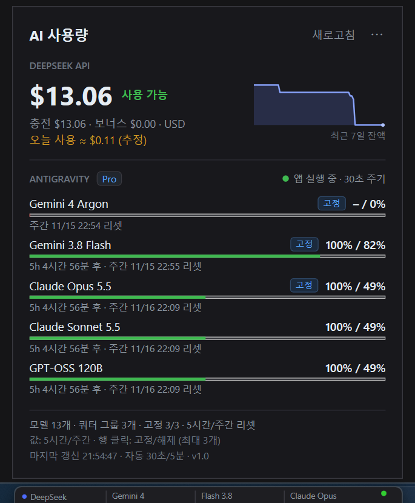
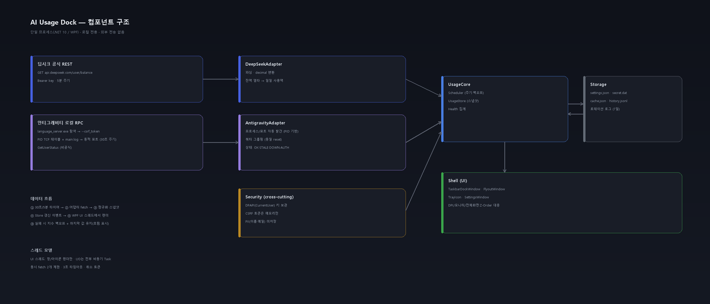

# AI Usage Dock

Windows 10 / 11 작업표시줄에 붙어서 **딥시크(DeepSeek) API 잔액**과 **안티그래비티(Antigravity) 모델별 잔여 쿼터**를 클릭 없이 한눈에 보여주는 **로컬 전용** 데스크톱 위젯입니다. (.NET 10 / WPF)

외부 중계 서버로 아무것도 전송하지 않으며, API 키는 Windows DPAPI로 암호화되어 현재 PC의 사용자 계정에만 저장됩니다.



---

## 주요 기능

### 🧩 작업표시줄 오버레이 독 (Taskbar Overlay Dock)
- 작업표시줄 트레이 왼쪽에 자연스럽게 배치되는 슬림 오버레이 독 (폭 428 DIP, 높이는 작업표시줄에 맞춤).
- **딥시크 API 잔액**과 **안티그래비티 상위 3개 모델 패밀리의 `5시간/주간` 잔여율**(예: `100% / 82%`)을 실시간으로 표시합니다.
- 작업표시줄 자동 숨김(Auto-hide) 상태에서도 위치를 추적해 동작합니다.

### 📊 상세 플라이아웃 패널 (Detailed Flyout)
독을 좌클릭하면 열리는 상세 패널에서 다음 정보를 제공합니다:
- **잔액 분해** — 총 잔액(`total_balance`), 충전 잔액(`topped_up_balance`), 크레딧(`granted_balance`) 구분 표시.
- **오늘 사용(추정)** — 로컬 시계열 스냅샷 차분 기반 일일 사용량 추정치.
- **7일 스파크라인** — 최근 7일간 잔액 추이 시각화.
- **안티그래비티 전체 모델(13종)** — 행마다 `5시간/주간` 잔여율과 두 창의 리셋 시각을 표시합니다.
- **모델 패밀리 고정(핀)** — 행을 클릭해 최대 **3개 모델 패밀리**를 독에 고정합니다. 고정된 행에는 파란 `고정` 칩이 표시됩니다.

### 🚦 4단계 상태 표시 (Health Indicator)
| 상태 | 표시 | 의미 |
|---|---|---|
| 정상 (`Ok`) | 초록 `●` | 두 데이터 소스 모두 최신 데이터 수신 성공 |
| 지연 (`Stale`) | 주황 `◐` | 갱신이 지연됨 (마지막 성공 값 유지) |
| 앱 종료 (`AppNotRunning`) | 회색 `○` | 안티그래비티 앱 미실행 (딥시크는 정상 표시) |
| 오류 (`Error`) | 빨강 `!` | API 키 미설정/인증 실패 또는 로컬 스키마 변경 |

- 일시적인 네트워크 오류가 발생해도 **마지막으로 성공한 값을 유지**해 화면이 비지 않습니다.

### 🪟 스마트 창 관리 (Smart Window Management)
- **전체화면 앱 자동 숨김** — 게임·영상 등 전체화면 앱 실행 시(`SHQueryUserNotificationState` 및 포그라운드 창 감지) 독이 자동으로 숨겨집니다.
- **다중 모니터 지원** — 설정에서 독을 표시할 작업표시줄(주 모니터 `Shell_TrayWnd` 또는 보조 모니터 `Shell_SecondaryTrayWnd`)을 선택할 수 있습니다.
- **비활성 오버레이 (`WS_EX_NOACTIVATE | WS_EX_TOOLWINDOW`)** — 작업 중인 창의 포커스를 빼앗지 않으며 `Alt+Tab` 목록에 나타나지 않습니다.

### 🔔 시스템 트레이 & 알림 (Tray & Notifications)
- 시스템 트레이 아이콘으로 언제든 **열기 / 지금 새로고침 / 설정 / 종료** 가능.
- **저잔액 / 저쿼터 알림** — 잔액 `< $2.00` 또는 쿼터 `< 15%` 임계값 하향 돌파 시 트레이 풍선 알림 1회 표시(회복 시 자동 재무장).
- **Windows 자동 시작** — 로그인 시 자동 실행(`HKCU\Software\Microsoft\Windows\CurrentVersion\Run`) 체크박스 제공.

### ⚡ 즉시 표시 & 보안 저장 (Cold Start & DPAPI)
- 시작 시 `%LOCALAPPDATA%\AiUsageDock\cache.json` 스냅샷으로 **즉시 표시** 후 백그라운드에서 갱신합니다.
- API 키는 `%LOCALAPPDATA%\AiUsageDock\secret.dat`에 **DPAPI (`DataProtectionScope.CurrentUser`)** 로 암호화 저장됩니다.

---

## 시스템 요구사항

| 항목 | 요구사항 |
|---|---|
| OS | **Windows 10 / Windows 11 (x64)** |
| 빌드 환경 | **[.NET 10.0 SDK](https://dotnet.microsoft.com/download/dotnet/10.0)** |
| 실행 환경 | **.NET 10.0 Desktop Runtime** (또는 자체 포함 게시) |
| 딥시크 연동 | *(선택)* [DeepSeek Platform](https://platform.deepseek.com/) API 키 |
| 안티그래비티 연동 | *(선택)* Antigravity 데스크톱 앱 실행 중 |

> 두 데이터 소스는 모두 **선택 사항**입니다. 하나만 사용해도 해당 정보만 정상 표시됩니다.

---

## 설치 및 빌드 (Getting Started)

다른 PC에서 저장소를 클론한 뒤 별도 설정 없이 바로 빌드·테스트·실행할 수 있습니다.

```powershell
# 1) 저장소 클론 및 이동
git clone https://github.com/judy1467/ai-usage-dock.git
cd ai-usage-dock

# 2) Release 빌드 (경고 0, 오류 0)
dotnet build AiUsageDock.slnx -c Release

# 3) 단위 테스트 실행 (24/24 통과)
dotnet test AiUsageDock.slnx -c Release

# 4) 앱 실행
dotnet run --project src\AiUsageDock.App -c Release
```

### 배포용 실행 파일 생성 (Publish)

프레임워크 종속 빌드 (권장, 용량 작음):

```powershell
dotnet publish src\AiUsageDock.App -c Release -r win-x64 --self-contained false -o publish
```

자체 포함 단일 배포 (.NET 런타임 미설치 PC용):

```powershell
dotnet publish src\AiUsageDock.App -c Release -r win-x64 --self-contained true -o publish
```

> [!IMPORTANT]
> **재빌드 전 파일 잠금 주의**: 이미 `AiUsageDock.App`이 실행 중이면 빌드 시 실행 파일 복사 오류(`MSB3021` / `MSB3027`)가 발생합니다. 재빌드 전에 트레이 아이콘(우클릭 → 종료) 또는 아래 명령으로 프로세스를 먼저 종료하세요.
> ```powershell
> Stop-Process -Name AiUsageDock.App -Force -ErrorAction SilentlyContinue
> ```

---

## 사용 방법 및 설정

### 마우스 조작
- **독 좌클릭** → 상세 플라이아웃 패널 열기 / 닫기 (`ESC` 또는 바깥 클릭 시 닫힘)
- **독 우클릭** 또는 **트레이 아이콘 우클릭** → 컨텍스트 메뉴 (`지금 새로고침`, `설정…`, `종료`)
- **플라이아웃의 모델 행 클릭** → 해당 패밀리를 독에 고정/해제 (최대 **3개**, 초과 시 안내 메시지). 고정된 행에는 `고정` 칩이 붙습니다.
- **값 표기** — `5시간/주간` 순서입니다(예: `100% / 82%`). Argon처럼 5시간 버킷이 없는 모델은 `– / 0%`로 표시됩니다.

### 딥시크 API 키 설정
두 가지 방법 중 하나를 선택할 수 있습니다:

1. **설정 창에서 입력 (권장)**
   - 독 우클릭 → **설정…** 클릭 → `DeepSeek API 키` 입력란에 `sk-...` 키를 입력하고 **저장**을 누릅니다.
   - 저장된 키는 DPAPI로 암호화되며, 설정 창을 다시 열면 `sk-abc…1234` 형태로 마스킹되어 표시됩니다.
2. **환경 변수 사용**
   - `DEEPSEEK_API_KEY` 환경 변수가 설정되어 있으면 별도 파일 저장 없이 자동으로 읽어들입니다.
   ```powershell
   $env:DEEPSEEK_API_KEY = "sk-..."
   ```

### 안티그래비티 연동 원리 (로컬 RPC 자동 탐색)
안티그래비티 데스크톱 앱이 실행 중이면 위젯이 자동으로 연결합니다:
1. 실행 중인 `language_server_windows_x64.exe` 프로세스의 커맨드라인에서 `--csrf_token` 인자를 추출합니다(콘솔 창 깜빡임 없이 Win32 `NtQueryInformationProcess`로 직접 조회).
2. 해당 프로세스가 리슨 중인 `127.0.0.1` 동적 포트들에 `POST https://127.0.0.1:<port>/exa.language_server_pb.LanguageServerService/GetUserStatus`를 호출해 응답 포트를 캐싱합니다.
3. 응답의 `cascadeModelConfigData.clientModelConfigs`에서 모델별 `remainingFraction`과 `resetTime`을 파싱해 표시합니다.

---

## 아키텍처 및 디렉터리 구조



### 프로젝트 구조

| 경로 | 설명 |
|---|---|
| [`AiUsageDock.slnx`](AiUsageDock.slnx) | .NET 10 솔루션 파일 |
| [`DESIGN.md`](DESIGN.md) | 상세 설계 문서 — 요구사항, 데이터 소스 실측, 아키텍처, UI, Win32, 보안, 테스트 |
| [`REVIEW.md`](REVIEW.md) | 구현 검증 리포트 — 발견·수정한 결함 및 검증 결과 |
| [`src/AiUsageDock.Core`](src/AiUsageDock.Core) | 핵심 도메인 모델, 딥시크/안티그래비티 어댑터, 모델 패밀리 그룹핑, DPAPI/캐시/히스토리 저장소, 폴링 스케줄러 |
| [`src/AiUsageDock.App`](src/AiUsageDock.App) | WPF 애플리케이션 — 작업표시줄 독(`MainWindow`), 상세 플라이아웃(`FlyoutWindow`), 설정(`SettingsWindow`), 트레이(`TrayIconHost`), Win32 Interop |
| [`tests/AiUsageDock.Core.Tests`](tests/AiUsageDock.Core.Tests) | xUnit 단위 테스트 (파서, 그룹핑, HTTP 스텁, 독 레이아웃 수식, 캐시/DPAPI 저장소 등 20개) |
| [`tools/probe.ps1`](tools/probe.ps1) | 두 데이터 소스(DeepSeek / Antigravity)를 독립적으로 호출·진단하는 PowerShell 스크립트 |
| [`tools/make_mocks.py`](tools/make_mocks.py) | `assets/` 내 아키텍처 다이어그램 및 UI 목업 이미지를 생성하는 Python 스크립트 |
| [`assets/`](assets) | 실행 검증 스크린샷 및 아키텍처 다이어그램 |

### 로컬 데이터 저장 경로 (`%LOCALAPPDATA%\AiUsageDock\`)

| 파일 | 설명 |
|---|---|
| `settings.json` | 표시할 모니터, 통화(`USD`/`CNY`), 가로 오프셋, 핀 고정 모델 패밀리, 전체화면 숨김, 자동 시작 설정 |
| `secret.dat` | Windows **DPAPI (`CurrentUser`)** 로 암호화된 딥시크 API 키 |
| `cache.json` | 마지막 성공 스냅샷 (앱 시작 시 빈 화면 없이 즉시 표시용, PII 제외) |
| `history.jsonl` | 7일 스파크라인 및 오늘 사용량 추정용 잔액 시계열 로그 |
| `startup.log` | 시작 및 예외 진단 로그 |

---

## 보안 및 개인정보 보호

- **DPAPI (`CurrentUser`) 암호화**: API 키는 현재 로그인한 Windows 사용자 계정으로만 복호화할 수 있는 `secret.dat`에 저장됩니다. 파일이 외부로 유출되더라도 다른 PC나 다른 계정에서는 복호화할 수 없습니다.
- **루프백 전용 TLS 예외 격리**: 안티그래비티 로컬 서버는 자기서명 인증서를 사용하므로 `IPAddress.IsLoopback(uri.Host)`(`127.0.0.1` / `localhost`)인 요청에만 인증서 예외를 허용하며, `api.deepseek.com`과 통신하는 `HttpClient`는 시스템 기본 TLS 검증을 엄격히 수행합니다.
- **개인식별정보(PII) 미저장**: 안티그래비티 응답에 포함될 수 있는 사용자 이름·이메일·API 키 등은 파서 단계에서 버려지며 `cache.json`이나 `history.jsonl`에 기록되지 않습니다.

---

## 문제 해결 (Troubleshooting)

### 1. 빌드 시 파일 잠금 오류 (`MSB3021` / `MSB3027`)
실행 중인 위젯이 빌드 출력 파일(`AiUsageDock.App.exe`)을 점유하고 있을 때 발생합니다.

```powershell
Stop-Process -Name AiUsageDock.App -Force -ErrorAction SilentlyContinue
dotnet build AiUsageDock.slnx -c Release
```

### 2. 안티그래비티 / 딥시크 연결 상태 직접 진단
문제가 데이터 소스 쪽인지 확인하려면 동봉된 진단 스크립트를 실행하세요:

```powershell
powershell -ExecutionPolicy Bypass -File tools\probe.ps1
```

- **안티그래비티가 `앱 꺼짐` 또는 `—`로 표시될 때**: Antigravity 데스크톱 앱이 실행 중인지 확인하세요. 실행 후 수 초 내에 자동으로 연결됩니다.
- **딥시크가 `키 설정` 또는 `키 오류`로 표시될 때**: 설정 창에서 `sk-`로 시작하는 유효한 API 키를 입력했는지 확인하세요.

