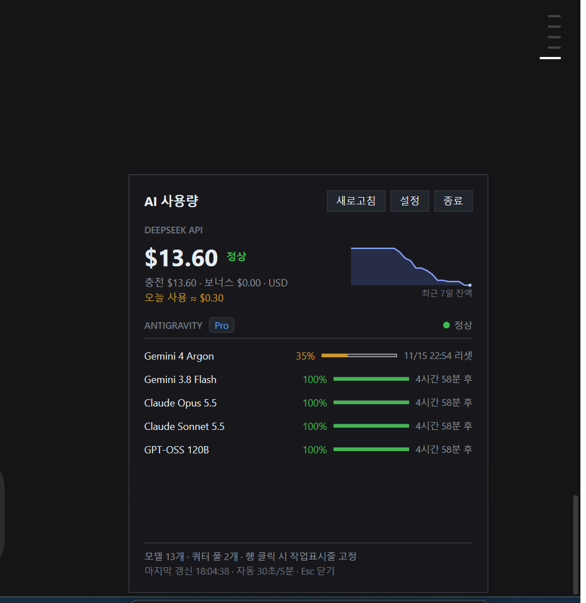

# 구현 검증 리포트

> 다른 에이전트가 구현한 위젯을 빌드·실행 검증하고, 발견된 결함과 설계 대비 격차를 구현·수정한 기록.
> **현재 상태: 빌드 경고 0, 테스트 20/20 통과, 실제 실행 확인.**



---

## 1. 검증 방법 (실제 수행)

```powershell
dotnet build AiUsageDock.slnx -c Release      # 경고 0, 오류 0
dotnet test  tests\AiUsageDock.Core.Tests      # 20/20 통과
```

- 실행 후 Win32로 창 rect/DPI/스타일/가시성 실측 (`SetThreadDpiAwarenessContext(PER_MONITOR_AWARE_V2)`)
- 독 클릭 → 플라이아웃, 바깥 클릭 → 닫힘, ESC → 닫힘
- 두 번째 인스턴스 실행 → 단일 인스턴스 확인
- 테두리 없는 전체화면 폼을 띄워 전체화면 숨김/복귀 확인
- `%LOCALAPPDATA%\AiUsageDock\` 파일(캐시/키/로그) 확인

## 2. 1차: 발견 → 수정한 결함

| # | 심각도 | 문제 | 수정 |
|---|---|---|---|
| 1 | **Critical** | API 키를 **하드코딩 XOR**로 저장 — 사실상 평문 | **DPAPI(CurrentUser)** 로 교체 + 기존 XOR 파일 자동 마이그레이션 |
| 2 | Major | 독 높이 36 DIP < 콘텐츠 → 하단 진행바 잘림 | 높이/패딩 재설계 (온-태스크바 40 DIP) |
| 3 | Major | **트레이 아이콘 없음** | `TrayIconHost` 추가(열기/새로고침/설정/종료) |
| 4 | Major | **단일 인스턴스 없음** → 독 중복 | `Local\AiUsageDock.SingleInstance` 뮤텍스 |
| 5 | Major | **자동 시작 미구현** | `StartupRegistrar` + 설정 체크박스 |
| 6 | Major | 플라이아웃 `Deactivated`에서 `Close()` 예외 | `SafeClose()` + Dispatcher 지연 |
| 7 | Minor | 500ms마다 `settings.json` 재읽기 | 메모리 캐시 |
| 8 | Minor | `icacls` 빌드 타깃, `.gitignore`가 bin/obj 포함 | 제거·수정 |
| 9 | Minor | 설정 창에서 **API 키 평문 표시** | `PasswordBox` + `sk-abc…1234` 마스킹 + 삭제 버튼 |

## 3. 2차: 설계 대비 남은 격차 구현

| 격차 | 구현 내용 | 검증 |
|---|---|---|
| 캐시 영속화 (`cache.json`) | 마지막 성공 스냅샷 저장/복원. 시작 시 즉시 표시 후 갱신 (설계 5.5) | 파일 2.3KB 생성, PII 없음 확인 |
| 전체화면 숨김 | `SHQueryUserNotificationState` + 포그라운드 창 rect 검사 (설계 8.5) | 전체화면 폼 → 숨김, 닫으면 복귀 확인 |
| 작업표시줄 자동 숨김 | `ABM_GETSTATE` + 태스크바 rect 기반 배치 (리빌 엣지 회피) | 배치 수식 단위 테스트 4건 |
| 독 위치 | 작업표시줄 **위에 겹침** (트레이 왼쪽), 높이는 태스크바에 맞춰 자동 | 물리 좌표 (3033,2094)-(3675,2154) 확인 |
| 7일 스파크라인 | 플라이아웃에 잔액 추이 (영역 채움 + 마지막 점) | 스크린샷 확인 |
| 저잔액/저쿼터 알림 | 임계값 교차 시 트레이 풍선 1회, 복구 시 재무장 | 코드 경로 (라이브 알림은 미검증) |
| 다중 모니터 | `Shell_SecondaryTrayWnd` 탐색 + 설정에서 표시할 작업표시줄 선택 | 단일 모니터 환경이라 열거만 확인 |
| 통합 테스트 | 파서 3 + HTTP 스텁 3 + 배치 7 + 캐시 4 등 **20개** | 20/20 통과 |

## 4. 미검증 / 남은 리스크

| 항목 | 상태 |
|---|---|
| 보조 모니터 작업표시줄 실제 배치 | 이 PC는 모니터 1대 → 열거/선택 코드만 확인 |
| 작업표시줄 자동 숨김 실기기 동작 | 설정을 바꾸지 않아 수식 테스트로만 확인 |
| 알림 풍선 실제 표시 | Windows 알림 설정에 의존. 임계값 교차 로직은 구현 |
| 안티그래비티 앱 업데이트 취약성 | 2.29.1 기준. 실패 시 `schema_changed`로 표시 |
| WPF 메모리 | 장시간 상주 측정은 미실시 |

## 5. 실행

```powershell
cd ai-usage-dock
dotnet run --project src\AiUsageDock.App -c Release
```

- 독 클릭 → 상세, 우클릭 → 메뉴, 트레이 아이콘 → 열기/새로고침/설정/종료
- 설정: API 키(마스킹), 통화, 오프셋, 표시할 작업표시줄, 전체화면 숨김, 자동 시작
- 데이터: `%LOCALAPPDATA%\AiUsageDock\` (`cache.json`, `history.jsonl`, `secret.dat`, `logs`)
- **빌드 전 실행 중인 앱을 종료**해야 한다(파일 잠금).

## 6. 참고

- 화면이 150% 배율이면 DPI 비인식 프로세스의 좌표는 1.5배 축소되어 보인다.
- `Graphics.CopyFromScreen`으로 만든 32bppArgb 비트맵은 알파가 0이라 PNG로 저장하면
  뷰어에 따라 흰색으로 보인다. 검증 캡처는 `Format32bppRgb`를 사용했다.
